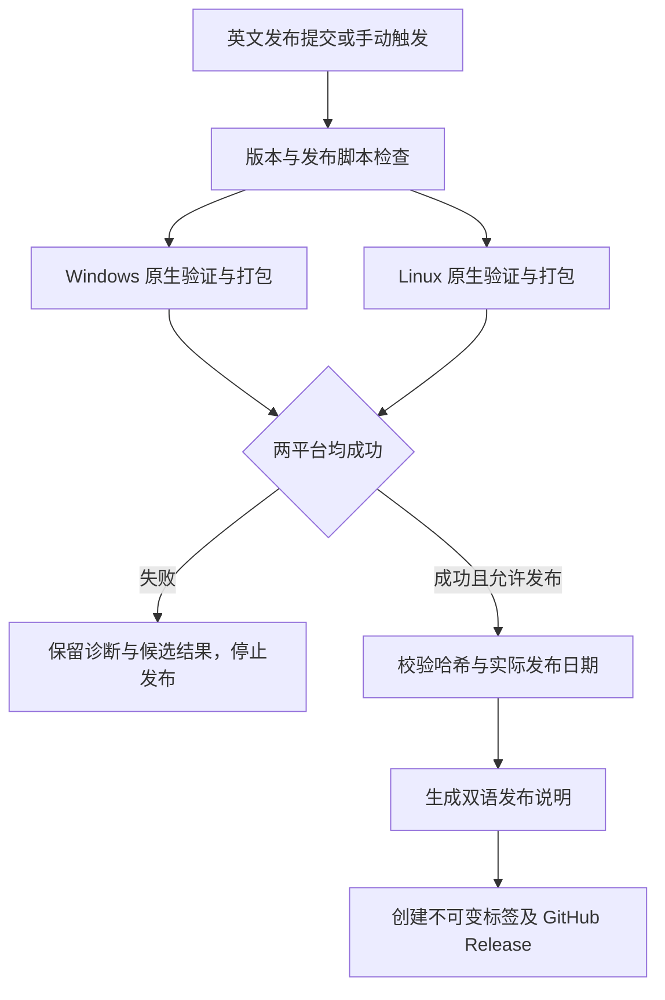

# TurboDBNote Windows / Linux 发布操作手册

本手册用于首次发布 `0.1.0`，以及后续版本快速发布。Git 提交信息统一使用英文，操作说明使用中文。

## 1. 当前状态与产物

截至 2026-10-12 本次整理时：

- 当前源码分支：`feat/mysql-driver`；候选提交：`27abbb0`。
- [候选构建](https://github.com/gavinwuz/TurboDbNote/actions/runs/38211908708)正在执行：版本检查通过；Linux 工作区编译检查、串行测试、Clippy 已通过，正在构建发行归档；Windows 正在验证及打包。
- `v0.1.0` GitHub Release 尚未创建。以上状态只是记录时间点，实际结果以 Actions 为准。
- 候选分支只构建验证，不自动公开发布；默认分支的 `[release]` 提交才会触发自动发布。

公开 Release 包含：

| 文件 | 用途 |
| --- | --- |
| `TurboDBNote-v0.1.0-windows-x64-portable.zip` | Windows 便携包 |
| `TurboDBNote-v0.1.0-linux-x64.tar.gz` | Linux x64 包 |
| `SHA256SUMS.txt` | 两个平台包的 SHA256 校验清单 |

Windows 安装 EXE 另外保留在 `release-windows` 工作流产物中，配套 EXE/PDB 保留在 `windows-symbols` 中；PDB 不进入公开用户包。Linux 包包含依赖清单与选定项目源码归档。

## 2. 首次发布 0.1.0

### 2.1 确认候选通过

打开候选构建链接，确认以下任务全部成功：

1. `metadata`：版本文件及发布说明一致，发布脚本回归测试通过。
2. `windows`：测试、固定版 Inno Setup、打包、驱动契约及隔离窗口启动成功。
3. `linux`：格式、编译检查、串行测试、Clippy、Release 构建、驱动契约及隔离 X11 窗口启动成功。

候选分支的 `publish` 为 `skipped` 属正常情况。任一平台失败，先按第 6 节修复，不提前创建版本标签。

### 2.2 将验证后的源码同步到默认分支

本仓库当前默认分支是 `main`。先保存并提交本地更改；`git status --short` 应为空。不要通过重置或清理删除未完成工作。

```powershell
git status --short
git fetch origin
git switch main
git pull --ff-only origin main
git merge --ff-only feat/mysql-driver
```

如果快进合并失败，说明两侧历史已分叉，应先解决分支整合并重新验证，不使用强制推送。

确认 `0.1.0` 元数据与说明完整：

```powershell
python scripts/test-release.py
python scripts/release.py --version 0.1.0 --notes target/release-notes-0.1.0.md
```

`0.1.0` 已是当前 workspace 版本，不要对首次发布调用 `release.ps1 -Version 0.1.0`；这个入口用于升级到更高版本。

### 2.3 触发正式发布

如果最新提交不含 `[release]`，增加一个英文发布标记提交；此提交只触发流水线，不改变应用行为：

```powershell
git commit --allow-empty -m "chore: publish v0.1.0 release [release]"
git push origin main
```

打开 [Release Windows and Linux 工作流](https://github.com/gavinwuz/TurboDbNote/actions/workflows/release.yml)。默认分支这次运行会再次检查并构建准确的发布提交；两平台成功后执行 `publish`。

不要在本机提前执行 `git tag v0.1.0`。工作流会在发布时对准确源码提交创建标签。

### 2.4 确认发布结果

打开 [v0.1.0 Release](https://github.com/gavinwuz/TurboDbNote/releases/tag/v0.1.0)，检查：

- 版本名为 `TurboDBNote v0.1.0`，不是草稿。
- 两个平台包与 `SHA256SUMS.txt` 均存在。
- 发布说明包含中英文，并与根目录对应版本的 CHANGELOG 一致。
- 标签指向本次通过验证的源码提交。

需要用 CLI 查看时，可使用已登录的 GitHub CLI：

```powershell
gh release view v0.1.0 --repo gavinwuz/TurboDbNote
gh run list --workflow release.yml --repo gavinwuz/TurboDbNote --limit 5
```

本地一键发布入口不依赖 GitHub CLI；这些命令只是可选查看方式。

## 3. 后续版本一键发布

以 `0.1.1` 为例，必须先把功能与修复提交到默认分支，并维护双语说明。

### 3.1 准备待发布内容

在以下两个文件的 `## [Unreleased]` 下分别增加对应语言的更新说明：

- `CHANGELOG.md`：英文。
- `CHANGELOG.zh-CN.md`：中文。

例如：

```markdown
## [Unreleased]

- Improve query result navigation and fix connection recovery.
```

中文版填写同义中文说明。提交时只添加明确需要的源码与文档路径，不将本机配置、凭据或用户数据加入仓库。

```powershell
git add CHANGELOG.md CHANGELOG.zh-CN.md
git commit -m "docs: describe the next release changes"
git push origin main
```

先提交功能更改，再提交说明也可以；所有提交信息使用英文。

### 3.2 同步并检查环境

```powershell
python --version
git status --short
git fetch origin
git switch main
git pull --ff-only origin main
```

要求 Python 3.11+，Git 能正常推送；工作区干净，当前默认分支 HEAD 与远端一致。仓库已采用 Rust 1.92.0 与锁定依赖，Windows/Linux 构建工具由 CI 准备。

### 3.3 执行一个发布命令

Windows PowerShell 7：

```powershell
./scripts/release.ps1 -Version 0.1.1
```

Linux：

```bash
python3 scripts/prepare-release.py 0.1.1
```

脚本自动完成：

1. 检查新版本格式、版本递增、干净工作区、默认分支同步及远端标签不存在。
2. 同步 workspace Cargo 版本与各项目包的 Cargo.lock 版本。
3. 更新 Windows VERSIONINFO 和 `crates/desktop/assets/release.json`。
4. 将双语 Unreleased 内容移动到新版本章节，并记录计划实际发布日期。
5. 更新中英文 README 的版本标识。
6. 创建英文提交，例如 `chore: prepare v0.1.1 release [release]`。
7. 推送默认分支，触发双平台验证与发布。

脚本推送成功只代表流水线已触发，不代表版本已发布。继续检查 Actions，直至 `publish` 成功。

## 4. GitHub 网页手动触发

当工作流文件已经进入默认分支后：

1. 打开仓库的 **Actions**。
2. 选择 **Release Windows and Linux**。
3. 点击 **Run workflow**，选择已准备好版本文件的分支。
4. `version` 填写与 Cargo 一致的版本，例如 `0.1.1`。
5. 只验证包时保持 `publish` 未勾选；正式发布时勾选。
6. 点击运行并等待所有检查。

网页输入版本号不会自动修改源码版本文件；版本与 Cargo/元数据不一致会直接失败。

## 5. 自动流水线做什么



平台构建分开执行，依赖及兼容组件使用缓存。旧候选可以被新候选取消，默认分支和标签发布运行保留顺序保护。

公开发布只上传两个平台包及校验清单；安装 EXE 和符号保留在工作流产物中。发布说明从根目录双语 CHANGELOG 生成，不另建重复的版本说明源文件。

## 6. 失败时如何处理

### Rust 检查或测试失败

查看失败任务的 **Annotations**。编译错误、源码位置及失败测试名称会给出脱敏后的摘要；完整日志需登录 GitHub。

修复源码后，在候选分支创建包含 `[release]` 的英文提交并推送，可重新验证：

```powershell
git add path/to/changed-file
git commit -m "fix: correct the release validation failure [release]"
git push origin HEAD
```

以上路径是示例，替换为实际修改文件。不要删除测试或关闭 Clippy 来绕过失败。

### 修复默认分支后重新发布

两种方式任选其一：

- 在已修复的默认分支创建带 `[release]` 的英文提交并推送。
- 网页 **Run workflow** 选择最新默认分支与相同的未发布版本，勾选 `publish`。

GitHub 的 **Re-run jobs** 会继续使用原运行的旧提交。源代码已变更时，应对新提交启动运行，而不是反复重跑旧提交。

### 发布日期不一致

发布日期不能冒充构建日期。若构建跨到下一天而版本尚未发布，更新：

- `crates/desktop/assets/release.json` 的 `released_on`。
- 两个 CHANGELOG 中对应版本章节日期。

日期以发布团队的 Asia/Shanghai 日历日为准，然后提交并重新触发验证。不要为失败的构建宣称已发布。

### 版本标签或 Release 已存在

脚本拒绝覆盖已发布版本。已经公开的版本发现问题，应发布更高版本；不要移动、删除或强制覆盖已有标签。

### GitHub 发布权限失败

检查失败是否发生在 `publish`：该任务声明 `contents: write`，使用 Actions 提供的 `GITHUB_TOKEN`。若仓库或组织策略禁止写入，需要管理员调整对应工作流权限。

不要把令牌写入源码、文档、命令参数或根目录配置文件；不需要为了普通发版新增本机明文令牌。

### 本地工作区或推送失败

- 工作区不干净：先处理已有更改，保留用户草稿与文件。
- 默认分支与 origin 不一致：先同步或整合分支。
- 推送失败：保留已经生成的英文提交，解决 Git 认证或远端问题后正常重推；不要再次运行版本升级命令把版本重复递增。

## 7. 下载、校验及运行

### Windows

从 Release 下载 Windows ZIP 与 `SHA256SUMS.txt`，计算 ZIP 的哈希并与清单对应行比较：

```powershell
(Get-FileHash .\TurboDBNote-v0.1.0-windows-x64-portable.zip -Algorithm SHA256).Hash.ToLowerInvariant()
```

解压后运行 `turbodbnote.exe`。保留同目录 `drivers`、许可及源码材料，不仅复制主 EXE。便携版数据位于程序旁的 `data`，笔记独立保存为 `.note` 文件。

### Linux

下载 Linux tar.gz 与校验文件；若两个平台包均已下载，可以直接：

```bash
sha256sum --check SHA256SUMS.txt
```

仅下载 Linux 包时校验清单对应行：

```bash
grep 'TurboDBNote-v0.1.0-linux-x64.tar.gz$' SHA256SUMS.txt | sha256sum --check
tar -xzf TurboDBNote-v0.1.0-linux-x64.tar.gz
cd TurboDBNote-v0.1.0-linux-x64
./turbodbnote
```

该 `grep` 只读取公开下载目录的校验文件，不用于搜索项目配置。

Linux 基线为 Ubuntu 22.04/glibc 2.35，需要桌面会话、Vulkan、fontconfig、libxkbcommon 和 unixODBC。包内 `*-dependencies.txt` 列出实际依赖。

Linux 密码仅保留在会话内存；Windows DPAPI、托盘、SQL Server 集成认证及随包旧版 MySQL DLL 仅 Windows 提供。隔离 X11/Xvfb 启动检查不代表所有 GPU、桌面或 Wayland 完整验收，也不代表所有数据库真实服务端已验收。

## 8. 本地打包（可选）

优先使用 Actions 正式流程。本地打包适合排查问题或准备候选，不会自动变成 GitHub Release。

Windows：已有标准安装位置的 Inno Setup 6、Windows SDK、MSVC、CMake、PowerShell 7 后执行：

```powershell
./scripts/package-windows.ps1 -IsccPath 'C:\Program Files (x86)\Inno Setup 6\ISCC.exe'
```

Linux：按 `.github/workflows/release.yml` 安装所需原生依赖后执行：

```bash
python3 scripts/package-linux.py
```

输出进入 `dist`。脚本拒绝覆盖已有输出，保留符号与源码材料；不要为重新打包删除用户笔记、数据库或配置。项目根目录受保护的 `config/` 配置不应读取或进入源码归档。

## 9. 常用入口

- [双平台工作流](../.github/workflows/release.yml)
- [Windows 一键发布入口](../scripts/release.ps1)
- [跨平台发布准备脚本](../scripts/prepare-release.py)
- [版本检查与发布说明生成](../scripts/release.py)
- [Windows 打包脚本](../scripts/package-windows.ps1)
- [Linux 打包脚本](../scripts/package-linux.py)
- [GitHub Actions](https://github.com/gavinwuz/TurboDbNote/actions/workflows/release.yml)
- [GitHub Releases](https://github.com/gavinwuz/TurboDbNote/releases)

驱动契约验证已统一为 Rust，Windows/Linux 共用同一个入口，此项不再依赖 Python：

```sh
cargo run --locked -j 1 -p turbodbnote-driver-host --example verify_contracts -- <解压目录>/drivers/native
```

验证仅启动本地模拟服务及自身创建的驱动进程，检查有界读取、拒绝写入、非法输入处理及正常回收，不代表真实数据库服务端验收。当前打包及窗口启动验证仍保留 Python 3.11。
